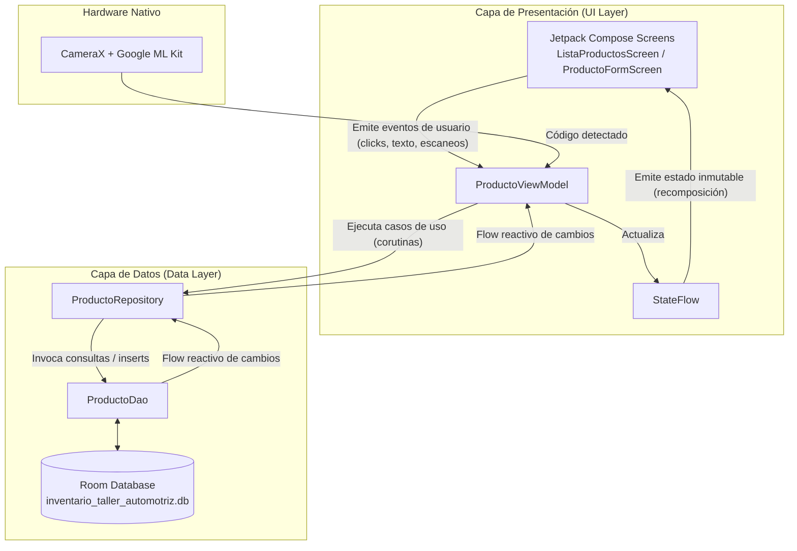
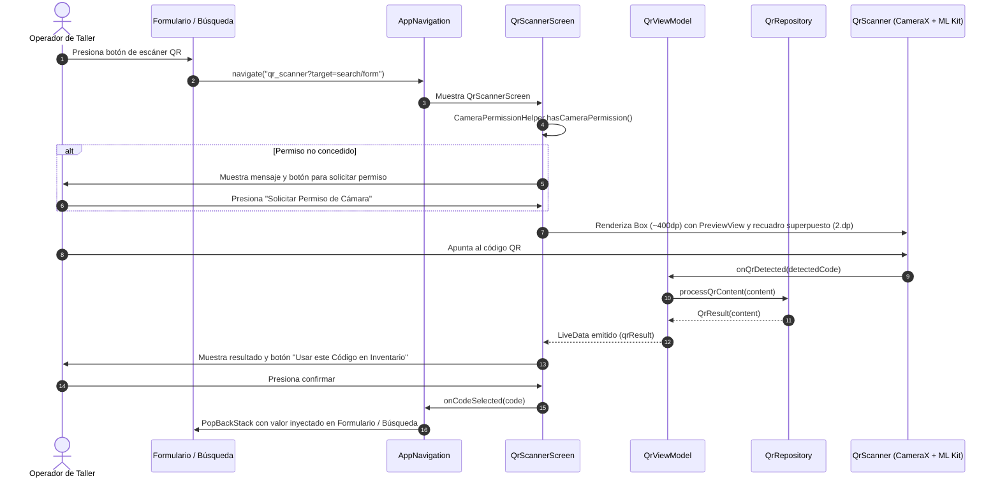

# DOCUMENTACIÓN TÉCNICA DE HITOS IMPLEMENTADOS
## Caso de Estudio: Sistema de Gestión de Inventario para Taller Automotriz (San Cristóbal - Puente Alto)
### Asignatura: DSY1105 - Desarrollo de Aplicaciones Móviles (Duoc UC)
### Primera Entrega: Módulo de Productos, Persistencia Local y Recursos Nativos

---

## 1. Estructura del Proyecto y Responsabilidades

El proyecto se estructuró siguiendo los principios de **Clean Architecture** y las directrices oficiales de Android Architecture Components, garantizando una alta cohesión interna y un bajo acoplamiento entre capas:

```
app/src/main/java/com/taller/inventario/
├── data/
│   ├── local/
│   │   ├── ProductoEntity.kt       # Modelo de persistencia y reglas de negocio encapsuladas
│   │   ├── ProductoDao.kt          # Interfaz de acceso a datos con SQLite / Room
│   │   └── AppDatabase.kt          # Instancia Singleton de la BD y precarga de datos iniciales
│   ├── model/
│   │   └── QrResult.kt             # Modelo de datos para el resultado de lectura QR
│   └── repository/
│       ├── ProductoRepository.kt   # Fuente única de verdad para productos (Single Source of Truth)
│       └── QrRepository.kt         # Procesamiento pedagógico del contenido QR
├── ui/
│   ├── navigation/
│   │   ├── AppNavigation.kt        # Definición del grafo NavHost de Jetpack Compose
│   │   └── Screen.kt               # Contrato sellado de rutas seguras con argumentos
│   ├── producto/
│   │   ├── ProductoUiState.kt      # Estado atómico e inmutable de la interfaz de usuario
│   │   ├── ProductoViewModel.kt    # Manejo de lógica de negocio, validaciones y StateFlow
│   │   ├── ListaProductosScreen.kt # Pantalla de catálogo, búsqueda interactiva y KPIs
│   │   ├── ProductoFormScreen.kt   # Pantalla de creación y edición estructurada en 3 secciones
│   │   └── components/
│   │       ├── ProductCard.kt      # Tarjeta con datos técnicos, bodega y reposición
│   │       └── StockBadge.kt       # Indicador semántico accesible (icono + texto + color)
│   ├── qr/
│   │   ├── QrViewModel.kt          # ViewModel con LiveData para gestión pedagógica del escaneo
│   │   └── QrScannerScreen.kt      # Pantalla con contenedor Box de ~400dp y recuadro superpuesto
│   └── theme/
│       ├── Color.kt                # Paleta industrial automotriz (Azul Mecánico y Naranja)
│       ├── Theme.kt                # Configuración Material Design 3 con soporte Edge-to-Edge
│       └── Type.kt                 # Escala tipográfica optimizada para entornos de taller
├── utils/
│   ├── CameraPermissionHelper.kt   # Verificación centralizada del permiso de cámara
│   └── QrScanner.kt                # Composable CameraX PreviewView (COMPATIBLE, FILL_CENTER, ML Kit)
├── InventarioApp.kt                # Application class para el ciclo de vida del contenedor
└── MainActivity.kt                 # Punto de entrada de la aplicación en Jetpack Compose
```

### Responsabilidades por Paquete:
* **`data.local`**: Responsable exclusivo del almacenamiento físico persistente mediante SQLite. No contiene ninguna dependencia de vistas ni del framework de UI.
* **`data.repository`**: Abstrae el origen de datos. Expone flujos reactivos (`Flow<T>`) al ViewModel y ejecuta operaciones asíncronas seguras con `Dispatchers.IO`.
* **`ui.producto`**: Contiene la presentación visual reactiva desacoplada del origen de datos. Los componentes reciben estados inmutables y emiten eventos unidireccionales (UDF).
* **`ui.producto.components`**: Componentes reutilizables, modulares y autocontenidos (tarjetas, escáner, insignias de stock).
* **`ui.navigation`**: Control centralizado del historial de pantallas y paso de parámetros sin acoplar las pantallas entre sí.

---

## 2. Arquitectura MVVM y Flujo Unidireccional de Datos (UDF)

La aplicación implementa rigurosamente el patrón **Model-View-ViewModel (MVVM)** combinado con **Clean Architecture**:



### Componentes de la Arquitectura:
1. **Model / Entity (`ProductoEntity`)**: Representa la estructura de datos del negocio del taller. Incluye métodos calculados puros para calcular la reposición automática (`cantidadSugeridaReposicion`) y resolver estados de stock de forma determinista.
2. **Repository (`ProductoRepository`)**: Encapsula el acceso a datos. Garantiza que la UI ignore si los datos provienen de Room, de memoria o de una API futura.
3. **ViewModel (`ProductoViewModel`)**: Gestiona la lógica de presentación y el ciclo de vida. No mantiene referencias a contextos de Activity ni elementos de View, evitando memory leaks.
4. **View (Compose UI)**: Funciones composables puras y sin estado (stateless) o impulsadas por el estado emitido por `uiState.collectAsState()`.

---

## 3. Navegación y Enrutamiento Seguro

La navegación se gestiona mediante la biblioteca oficial `androidx.navigation:navigation-compose`.

### Contrato de Rutas (`Screen.kt`):
```kotlin
sealed class Screen(val route: String) {
    data object ListaProductos : Screen("lista_productos")
    data object ProductoForm : Screen("producto_form?codigo={codigo}") {
        fun createRoute(codigo: String? = null): String {
            return if (codigo.isNullOrBlank()) "producto_form" else "producto_form?codigo=$codigo"
        }
    }
}
```

### Flujo de Pantallas:
* **Lista a Creación**: El usuario presiona el `FloatingActionButton` (+) $\rightarrow$ Se navega a `producto_form` sin argumentos. El ViewModel limpia el formulario (`prepararNuevoProducto()`).
* **Lista a Edición**: El usuario presiona el icono de editar en cualquier `ProductCard` $\rightarrow$ Se navega a `producto_form?codigo=ACE-CAST-5W30`. El ViewModel carga los datos del repuesto desde Room (`cargarProductoParaEditar(codigo)`).
* **Retorno automático**: Al completar un guardado exitoso en el formulario, el efecto `LaunchedEffect(uiState.guardadoExitosamente)` detecta el cambio, restablece la bandera y ejecuta `navController.popBackStack()`.
* **Escáner QR**: No es una pantalla acoplada, sino un diálogo modal desacoplado (`QrScannerDialog`) que puede activarse tanto desde la barra de búsqueda como desde el campo de código del formulario.

---

## 4. Listado de Productos y Dashboard Reactivo

La pantalla `ListaProductosScreen` actúa como consola de supervisión operativa para el encargado de bodega del taller:

* **Métricas Clave (KPIs en tiempo real):**
  - **Total Items**: Cuenta el número total de repuestos dados de alta.
  - **Bajo Stock**: Cuenta e identifica repuestos que están en o por debajo del stock mínimo. Es **interactivo**: presionar la tarjeta activa el filtro rápido "Solo Bajo Stock".
  - **Reposición Sugerida Total**: Sumatoria global de unidades recomendadas a comprar por el taller.
* **Barra de Búsqueda Reactiva**:
  Filtra instantáneamente por:
  - Nombre del repuesto (ej. "Aceite", "Filtro").
  - Código identificador (ej. "ACE-CAST", "FLT-MANN").
  - Marca automotriz (ej. "Castrol", "Bosch", "Brembo").
  - Ubicación física (ej. "Zona A", "Estante 2").
* **Selector Horizontal de Categorías**:
  Implementado con `FilterChip` interactivos con desplazamiento horizontal ("Todas", "Lubricantes", "Filtros", "Frenos", "Encendido", "Suspensión", "Accesorios").
* **Tarjeta de Producto (`ProductCard`):**
  - Código en tipografía monospace destacado en contenedor neutral.
  - Insignia semántica de stock (`StockBadge`).
  - Nombre del repuesto en tipografía destacada y marca en color de acento.
  - Comparativa de stock actual vs. stock mínimo con alerta de color.
  - Precios referenciales en pesos chilenos formateados (`$38.990` venta / `$27.990` costo).
  - Alerta de reposición sugerida destacada si $\text{reposición} > 0$.
  - Desglose de ubicación en bodega (`Zona A • Estante 1 • Repisa A`).
  - Proveedor principal asignado con icono de transporte/logística.
  - Botones de acción directa para editar o eliminar (con diálogo de confirmación).

---

## 5. Formulario de Productos (Alta y Edición)

La pantalla `ProductoFormScreen` está estructurada en 3 tarjetas lógicas con elevación y delineado para minimizar la fatiga visual en bodega:

1. **Sección 1: Identificación del Repuesto**
   - **Código de Repuesto**: Campo obligatorio. En modo creación permite escribirlo manualmente o rellenarlo instantáneamente con el botón de escáner QR. En modo edición queda bloqueado (`enabled = false`) protegiendo la clave primaria.
   - **Nombre**: Denominación comercial completa del repuesto.
   - **Marca**: Fabricante automotriz obligatorio (ej. Castrol, Mann Filter, Bosch).
   - **Categoría**: Chips de selección rápida combinados con el estado del formulario.
2. **Sección 2: Stock y Precios Referenciales**
   - **Unidad de Medida**: Selector de tipo ("Unidad", "Litros", "Bidón", "Kit", "Juego", "Caja").
   - **Cantidad Actual y Stock Mínimo**: Campos con teclado numérico. Al modificar estos valores, el formulario actualiza en tiempo real el `StockBadge` resultante y la **Reposición Sugerida Calculada**.
   - **Precios Referenciales**: Precios de compra y venta en CLP, con validación de rentabilidad mínima.
3. **Sección 3: Ubicación en Bodega y Proveedor**
   - **Distribución física**: Tres campos sincronizados: Zona/Sector (ej. "A"), Estante (ej. "1") y Repisa/Nivel (ej. "B").
   - **Proveedor**: Nombre o razón social del distribuidor mayorista asignado.

---

## 6. Sistema de Validaciones y Errores Visuales en Compose

El sistema aplica validaciones estrictas en el ViewModel (`validarYGuardar()`) antes de cualquier persistencia. Si alguna regla se incumple, se genera un mensaje descriptivo específico por campo en `ProductoUiState`:

### Reglas de Negocio Implementadas:
| Campo / Regla | Condición de Validación | Mensaje de Error en UI |
|---|---|---|
| **Código** | No puede estar vacío ni compuesto solo de espacios. | *"El código de repuesto es obligatorio"* |
| **Código Duplicado** | Al crear, no debe existir previamente en Room. | *"El código 'XYZ' ya existe en el inventario"* |
| **Nombre** | No puede estar vacío. | *"El nombre del producto es obligatorio"* |
| **Marca** | No puede estar vacía. | *"La marca es obligatoria (ej. Bosch, Castrol)"* |
| **Categoría** | No puede estar vacía. | *"La categoría es obligatoria"* |
| **Cantidad** | Entero numérico $\ge 0$. | *"Debe ingresar una cantidad entera válida (≥ 0)"* |
| **Stock Mínimo** | Entero numérico $\ge 0$. | *"Debe ingresar un stock mínimo válido (≥ 0)"* |
| **Precios $\ge 0$** | Numéricos positivos o cero. | *"El precio referencial debe ser ≥ 0"* |
| **Margen Comercial** | $\text{Precio Venta} \ge \text{Precio Compra}$ | *"El precio de venta (\$X) no puede ser menor al de compra (\$Y)"* |

### Integración Visual en Jetpack Compose:
Siguiendo las mejores prácticas de Material Design 3, cada campo integra los estados de error reactivos:
```kotlin
OutlinedTextField(
    value = uiState.nombre,
    onValueChange = { viewModel.onNombreChange(it) },
    label = { Text("Nombre del Repuesto *") },
    isError = uiState.nombreError != null,
    supportingText = {
        uiState.nombreError?.let {
            Text(text = it, color = MaterialTheme.colorScheme.error)
        }
    }
)
```
Al teclear un nuevo valor en el campo que falló, el ViewModel automáticamente limpia el error (`nombreError = null`) restaurando el campo a su estado normal.

---

## 7. Gestión de Estado con StateFlow y ProductoUiState

Para garantizar reactividad inmediata y evitar inconsistencias, el estado de la UI se modela mediante un único `data class` inmutable:

```kotlin
data class ProductoUiState(
    val codigo: String = "",
    val nombre: String = "",
    val marca: String = "",
    val categoria: String = "Lubricantes",
    val unidadMedida: String = "Unidad",
    val cantidad: String = "0",
    val stockMinimo: String = "5",
    val precioCompra: String = "",
    val precioVenta: String = "",
    val ubicacionZona: String = "A",
    val ubicacionEstante: String = "1",
    val ubicacionRepisa: String = "A",
    val proveedorNombre: String = "",
    val estado: String = ProductoEntity.ESTADO_DISPONIBLE,
    // Errores independientes
    val codigoError: String? = null,
    val nombreError: String? = null,
    // Banderas de control
    val isEditing: Boolean = false,
    val guardando: Boolean = false,
    val guardadoExitosamente: Boolean = false,
    val searchQuery: String = "",
    val filtroCategoria: String = "Todas",
    val soloBajoStock: Boolean = false,
    val productos: List<ProductoEntity> = emptyList(),
    val showScanner: Boolean = false
)
```

### Ventajas de este enfoque:
1. **Unidireccionalidad**: La UI solo puede leer el estado y emitir eventos; no puede mutar los datos directamente.
2. **Combina flujos reactivos de Room**: El ViewModel utiliza el operador `combine(...)` entre la base de datos local y los criterios de búsqueda:
   ```kotlin
   combine(
       repository.getAllProductos(),
       _searchQuery,
       _categoriaFiltro,
       _soloBajoStock
   ) { productos, query, categoria, soloBajo ->
       // Filtrado reactivo en memoria secundaria
   }.stateIn(viewModelScope, SharingStarted.WhileSubscribed(5000), emptyList())
   ```
   Cualquier inserción o edición en Room refresca la lista de forma automática e inmediata en pantalla sin necesidad de llamadas manuales a `reload()`.

---

## 8. Persistencia Local con Room Database

### A. Estructura de la Entidad (`ProductoEntity`):
* Mapeada a la tabla `productos`.
* Clave primaria definida en `@PrimaryKey val codigo: String`.

### B. Objeto de Acceso a Datos (`ProductoDao`):
* Métodos reactivos que retornan `Flow<List<ProductoEntity>>` para que la UI observe cambios en tiempo real.
* `insertOrUpdate(producto: ProductoEntity)` con estrategia `OnConflictStrategy.REPLACE`.
* Consultas avanzadas de búsqueda con comodines `%` en SQLite:
  ```sql
  SELECT * FROM productos 
  WHERE nombre LIKE '%' || :query || '%' 
     OR codigo LIKE '%' || :query || '%' 
     OR marca LIKE '%' || :query || '%'
  ORDER BY nombre ASC
  ```

### C. Precarga Inicial sin Pérdida de Datos (`AppDatabase`):
* Configuración Singleton con exclusión mutua `synchronized(this)`.
* Implementación de `RoomDatabase.Callback` en `onCreate`:
  Cuando el usuario ejecuta la aplicación por primera vez, una corutina en segundo plano (`Dispatchers.IO`) inserta 6 registros automotrices sintéticos representativos:
  1. Aceite Sintético Castrol Edge 5W-30 (Disponible, Stock: 16).
  2. Filtro de Aceite Mann Filter HU 711/51 x (Bajo Stock: 3, Mínimo: 6).
  3. Líquido de Frenos Bosch DOT 4 500ml (Agotado: 0, Mínimo: 5).
  4. Bujías de Iridio NGK Laser ILZKR7B-11 (Disponible, Stock: 10).
  5. Pastillas de Freno Brembo Cerámicas (Bajo Stock: 4, Mínimo: 4).
  6. Filtro de Aire Motor Bosch (Disponible, Stock: 14).
* Se agregó `repository.verificarYPrecargarSiVacio()` al iniciar el ViewModel para proteger la persistencia en caso de limpiezas accidentales.

---

## 9. Integración de Hardware Nativo (Cámara con CameraX y Google ML Kit - Enfoque Pedagógico)

El módulo de captura física resuelve la necesidad de los operarios de taller de registrar piezas sin digitar códigos manuales. Adopta la estructura didáctica del docente:



### Componentes de la Refactorización Pedagógica:
1. **Modelo de Datos (`QrResult.kt`)**: Modela el contenido decodificado del código QR.
2. **Repositorio (`QrRepository.kt`)**: Encapsula el procesamiento del contenido capturado antes de enviarlo a la capa de presentación.
3. **Helper de Permisos (`CameraPermissionHelper.kt`)**: Centraliza la verificación de `Manifest.permission.CAMERA` mediante `ContextCompat.checkSelfPermission`.
4. **Composable de Escaneo (`QrScanner.kt`)**:
   - `PreviewView` con `implementationMode = PreviewView.ImplementationMode.COMPATIBLE` y `scaleType = PreviewView.ScaleType.FILL_CENTER`.
   - `DisposableEffect` con `Executors.newSingleThreadExecutor()` y banderas `AtomicBoolean` (`disposed`, `detected`).
   - Configuración de ML Kit con `BarcodeScannerOptions.Builder().setBarcodeFormats(Barcode.FORMAT_QR_CODE).build()`.
   - `ImageAnalysis.Builder().setBackpressureStrategy(ImageAnalysis.STRATEGY_KEEP_ONLY_LATEST).build()`.
   - Liberación estricta de recursos en el `onDispose` (shutdown del executor, `unbindAll` y cierre del cliente ML Kit).
5. **ViewModel (`QrViewModel.kt`)**:
   - Manejo de `LiveData<QrResult?>` y `MutableLiveData`.
   - Métodos `onQrDetected(content)` y `clearResult()`.
6. **Pantalla de Escaneo (`QrScannerScreen.kt`)**:
   - Contenedor `Box` con altura acotada a ~400dp.
   - Recuadro superpuesto delimitador (`Surface` con borde de `2.dp` en el color primario de la app).
   - Control de escaneo (`isScanning`), previsualización del código detectado y confirmación explícita para evitar registros erróneos.

---

## 10. Guía Paso a Paso para Pruebas y Evidencias de Evaluación

Para obtener las capturas de pantalla requeridas por la rúbrica de evaluación de Duoc UC, siga estos pasos:

### Prueba 1: Verificación de Precarga Inicial y Listado
1. Instale y abra la aplicación.
2. Compruebe que la pantalla inicial cargue automáticamente los 6 productos de ejemplo con sus badges de color (*Disponible* en verde, *Bajo Stock* en ámbar y *Agotado* en rojo).
3. Verifique que el panel superior muestre los KPIs: Total Items, Bajo Stock y Reposición Sugerida Total.
> **Evidencia 1 a capturar**: Captura de pantalla de la lista inicial con los productos precargados y los badges visibles.

### Prueba 2: Búsqueda Reactiva y Filtro por Categorías
1. En la barra de búsqueda superior, escriba `Castrol`. Observe cómo la lista se filtra inmediatamente mostrando solo el bidón de aceite.
2. Limpie la búsqueda y seleccione el chip `Frenos`. Observe que únicamente se listan las pastillas Brembo y el líquido Bosch.
3. Presione el KPI `BAJO STOCK`. Verifique que se filtren los repuestos con stock crítico.
> **Evidencia 2 a capturar**: Captura de pantalla con un filtro de categoría aplicado y búsqueda activa.

### Prueba 3: Escaneo de Código QR con Cámara (Flujo Pedagógico)
1. Toque el botón de escáner (icono de código QR) en la barra de búsqueda o en el formulario de creación de repuestos.
2. La aplicación navegará a la pantalla `QrScannerScreen`. Si no cuenta con permisos, mostrará el botón de solicitud correspondiente (`CameraPermissionHelper`).
3. Con el permiso concedido, se desplegará el visor de ~400dp con el recuadro superpuesto delimitador de `2.dp`.
4. Apunte el visor a un código QR (ej. `ACE-CAST-5W30`). Al detectarlo, `QrViewModel` recibirá el resultado procesado por `QrRepository` y detendrá el escaneo.
5. Se presentará el código detectado en pantalla con la opción de confirmar ("Usar este Código en Inventario") o reintentar ("Volver a Escanear").
6. Al presionar confirmar, la aplicación regresará a la pantalla previa inyectando automáticamente el código en el buscador o en el formulario.
> **Evidencia 3 a capturar**: Captura de pantalla de `QrScannerScreen` con el visor de cámara activo o con el código detectado listo para confirmar.

### Prueba 4: Validación de Formulario (Manejo de Errores)
1. Presione el botón flotante (+) para abrir el formulario de nuevo repuesto.
2. Deje todos los campos vacíos y presione el botón inferior **Guardar Producto**.
3. Verifique que los campos obligatorios (Código, Nombre, Marca, Categoría) se marquen en rojo con sus respectivos mensajes de error.
4. Ingrese un precio de venta menor al de compra (ej. Compra: 20000, Venta: 15000). Compruebe el mensaje de error de margen comercial.
> **Evidencia 4 a capturar**: Captura del formulario mostrando los mensajes de error en rojo.

### Prueba 5: Creación de Nuevo Producto y Persistencia tras Reinicio
1. Complete los datos de un nuevo repuesto:
   - Código: `NEU-MICH-205`
   - Nombre: `Neumático Primacy 4 205/55 R16`
   - Marca: `Michelin`
   - Categoría: `Neumáticos`
   - Cantidad: `2`
   - Stock Mínimo: `4` (Compruebe que la reposición sugerida calcule automáticamente $4 \times 2 - 2 = 6$).
   - Precio Compra: `65000`
   - Precio Venta: `89990`
   - Ubicación: Zona `C`, Estante `3`, Repisa `A`.
   - Proveedor: `Distribuidora Michelin Chile`.
2. Presione **Guardar Producto**. La aplicación guardará en Room y volverá automáticamente al catálogo mostrando el nuevo neumático.
3. **Prueba de Persistencia**: Cierre completamente la aplicación (remuévala de aplicaciones recientes en Android) o reinicie el emulador/dispositivo. Vuelva a abrirla.
4. Verifique que el neumático creado y los datos editados sigan presentes en Room Database sin ninguna pérdida.
> **Evidencia 5 a capturar**: Captura del catálogo tras reiniciar la aplicación demostrando la persistencia en Room.

### Prueba 6: Edición y Eliminación
1. En la tarjeta del nuevo neumático, toque el botón de editar (icono lápiz). Verifique que los campos se precarguen con los valores existentes y que el código esté protegido contra edición.
2. Modifique la cantidad de `2` a `10` y presione **Actualizar**. Compruebe que en la lista el badge cambie a *Disponible* en verde.
3. Presione el botón de eliminar (icono papelera). Se desplegará un `AlertDialog` de confirmación. Confirme la eliminación y compruebe que el ítem desaparezca inmediatamente de la lista.
> **Evidencia 6 a capturar**: Captura del diálogo de confirmación de eliminación.

---

## 11. Resultados de Compilación y Pruebas Unitarias

El proyecto cuenta con verificación continua y ejecución exitosa de pruebas unitarias locales:

```bash
./gradlew testDebugUnitTest assembleDebug
```

* **Estado de Compilación**: `BUILD SUCCESSFUL in 48s`
* **APK Generada**: `app/build/outputs/apk/debug/app-debug.apk` (41.7 MB).
* **Pruebas Automatizadas (`ProductoEntityTest.kt`)**: 4 de 4 pruebas aprobadas al 100%:
  - `regla de reposicion automatica sugiere el doble del minimo menos la cantidad`: **PASSED**
  - `regla de reposicion retorna cero cuando el inventario supera el doble del stock minimo`: **PASSED**
  - `resolver estado stock clasifica correctamente en AGOTADO, BAJO_STOCK y DISPONIBLE`: **PASSED**
  - `ubicacion detallada de bodega formatea correctamente zona, estante y repisa`: **PASSED**
