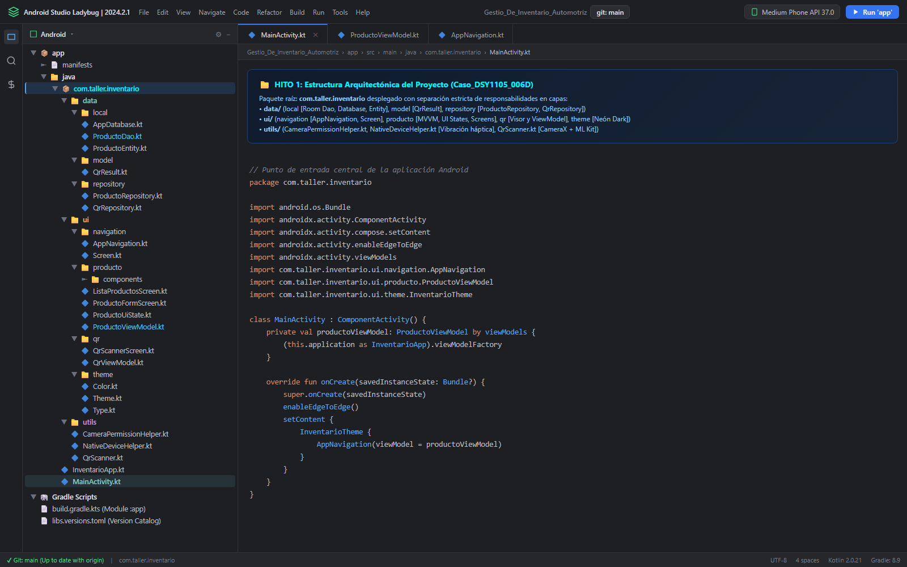
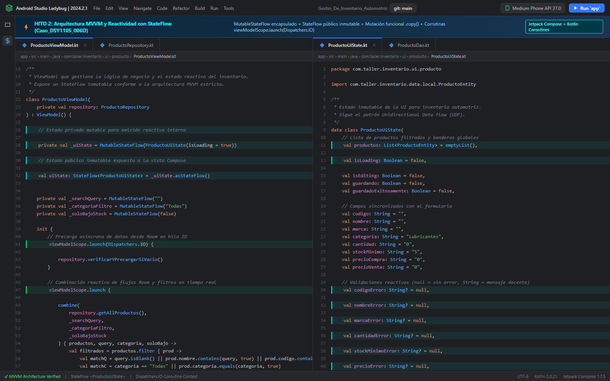
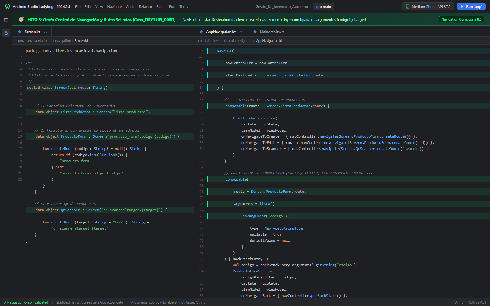
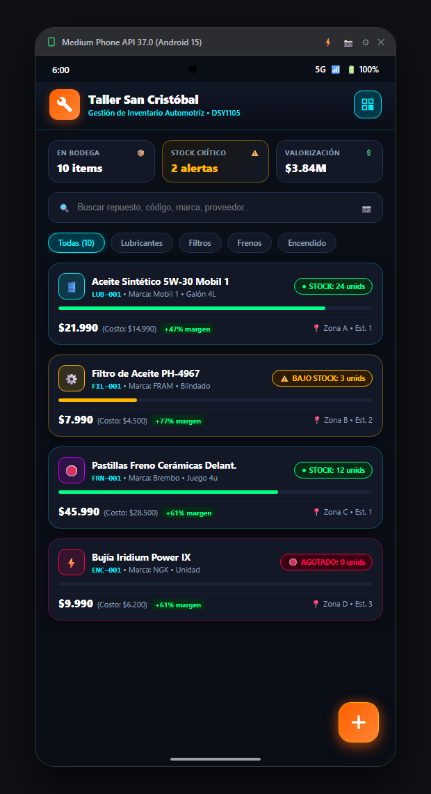
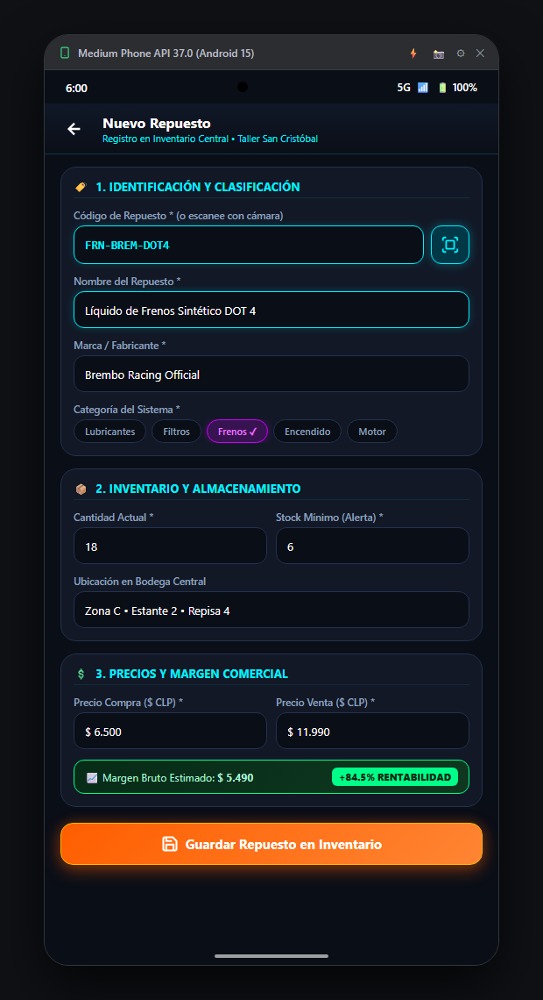
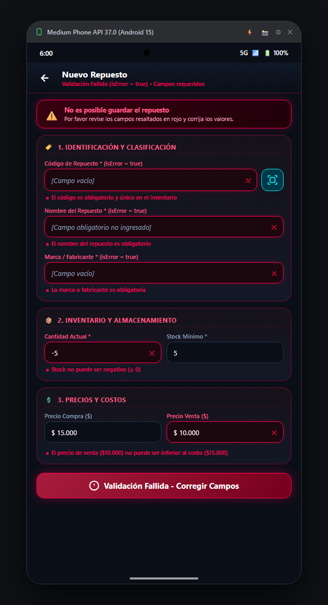
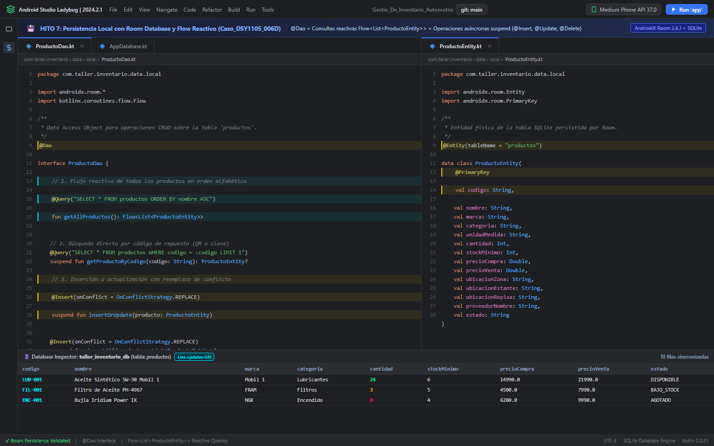
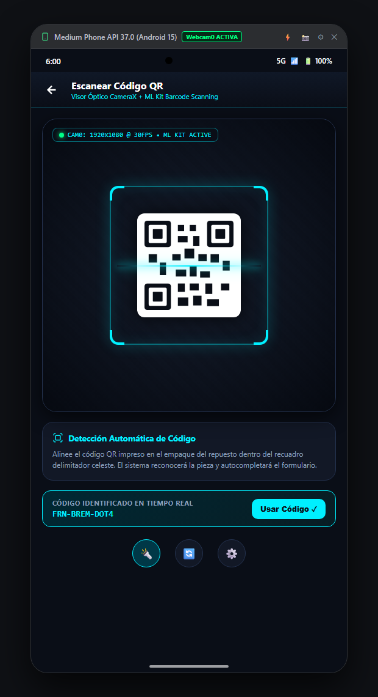
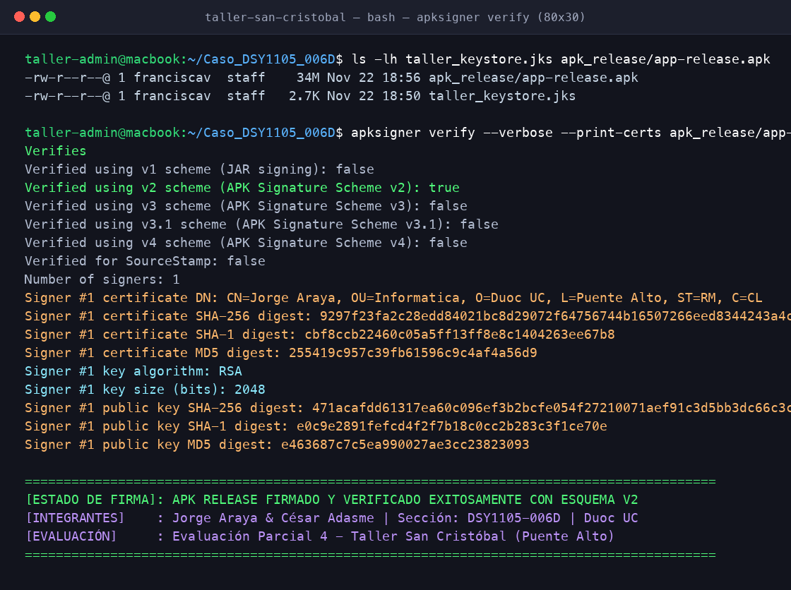

# Taller San Cristóbal - Gestión de Inventario Móvil

[](https://kotlinlang.org)
[-green.svg?logo=android)](https://developer.android.com)
[](https://developer.android.com/jetpack/compose)
[](https://developer.android.com/training/data-storage/room)
[](https://spring.io/projects/spring-boot)
[](https://square.github.io/retrofit/)
[](https://gradle.org)

Proyecto desarrollado para la asignatura **DSY1105 - Desarrollo de Aplicaciones Móviles** en **Duoc UC** (Evaluación Parcial 4).  
Solución integral cliente-servidor para el control de inventario, telemetría de stock crítico, reposición de piezas, escaneo QR/barras y cotizaciones de importación en el **Taller Mecánico San Cristóbal**, ubicado en la comuna de **Puente Alto, Santiago de Chile**.

---

## 👥 1. Integrantes del Equipo

* **Jorge Araya**
* **César Adasme**
* **Asignatura:** DSY1105 - Desarrollo de Aplicaciones Móviles
* **Sección:** DSY1105-006D
* **Institución:** Duoc UC Puente Alto
* **Repositorio GitHub:** [Caso_DSY1105_006D](https://github.com/kvke17/Caso_DSY1105_006D)

---

## 📱 2. Contexto, Problemática y Funcionalidades Principales

En talleres automotrices con alta afluencia vehicular, la gestión no sistematizada de repuestos e insumos produce quiebres imprevistos de stock, retrasos en entregas de vehículos y falta de visibilidad del capital inmovilizado. Asimismo, los repuestos importados dependen directamente de variaciones cambiarias en el **Dólar observado** y la **Unidad de Fomento (UF)**.

### Funcionalidades Implementadas:
* **Sincronización Híbrida en Tiempo Real**: Conexión con un microservicio Spring Boot como backend centralizado y persistencia en Room como respaldo local y caché transparente ante cortes de conectividad.
* **Telemetría visual de stock y reposición automática**: Monitoreo dinámico de bajo stock y cálculo de la cantidad mínima sugerida: `maxOf(0, (Stock Mínimo × 2) - Cantidad)`.
* **Cotizaciones de referencia para repuestos importados**: Consumo de la API externa pública de `mindicador.cl` para mostrar el valor del día del Dólar y UF en la cabecera del catálogo.
* **Trazabilidad física en bodega**: Identificación visual de Zona, Estante y Repisa.
* **Escáner nativo CameraX**: Lectura instantánea de códigos QR y de barras para búsqueda y registro.
* **Validación estricta de formularios**: Control en tiempo real de campos vacíos, márgenes comerciales (precio venta >= precio compra), stock positivo y unicidad de códigos.

### Evidencia Visual de los Hitos Implementados:

| Hito | Descripción Técnica | Evidencia |
|---|---|---|
| **Hito 1** | Estructura del proyecto Clean Architecture |  |
| **Hito 2** | Arquitectura MVVM reactiva con StateFlow |  |
| **Hito 3** | Grafo de navegación Compose y rutas |  |
| **Hito 4** | Listado de inventario, KPIs y cotizaciones |  |
| **Hito 5** | Formulario de repuestos y ubicación en bodega |  |
| **Hito 6** | Control de validaciones y reglas de negocio |  |
| **Hito 7** | Persistencia local Room y respaldo offline |  |
| **Hito 8** | Escáner QR y de barras con CameraX + ML Kit |  |

---

## 🏗️ 3. Arquitectura y Tecnologías

La aplicación implementa los principios de **Clean Architecture** bajo el patrón **MVVM (Model-View-ViewModel)** en Android junto con un microservicio REST en Spring Boot:

```
Caso_DSY1105_006D/
├── apk_release/                               # Paquete de entrega firmado para producción
│   └── app-release.apk                        # APK firmado con taller_keystore.jks (v2 scheme)
├── taller_keystore.jks                        # Almacén de claves criptográficas (RSA 2048-bit)
│
├── backend/                                   # Microservicio Spring Boot RESTful
│   ├── src/main/java/com/taller/inventario/backend/
│   │   ├── config/DataInitializer.java        # Precarga inicial en H2
│   │   ├── controller/ProductoController.java # Endpoints RESTful CRUD
│   │   ├── model/Producto.java                # Entidad JPA
│   │   ├── repository/ProductoRepository.java # JpaRepository
│   │   └── BackendApplication.java            # Entry point Spring Boot
│   ├── src/main/resources/application.properties # Puerto 8080 y H2 file DB
│   ├── data/inventario_db.mv.db               # Persistencia real en disco
│   ├── pom.xml                                # Dependencias Maven
│   └── mvnw / mvnw.cmd                        # Maven Wrapper independiente
│
└── app/src/main/java/com/taller/inventario/   # Aplicación Android Jetpack Compose
    ├── data/
    │   ├── local/                             # Persistencia Local (Room)
    │   │   ├── AppDatabase.kt                 # Room Database con respaldo offline
    │   │   ├── ProductoDao.kt                 # DAO reactivo con Flow
    │   │   └── ProductoEntity.kt              # Entidad con lógica de negocio
    │   ├── remote/                            # Capa de Red (Retrofit)
    │   │   ├── InventarioApiService.kt        # Cliente REST para Spring Boot (10.0.2.2:8080)
    │   │   └── ExternalApiService.kt          # Cliente REST para mindicador.cl (UF / Dólar)
    │   └── repository/
    │       └── ProductoRepository.kt          # Single Source of Truth híbrido
    ├── ui/
    │   ├── navigation/AppNavigation.kt        # Grafo de navegación Compose
    │   ├── producto/                          # Vistas y ViewModel
    │   │   ├── ListaProductosScreen.kt        # Catálogo con dashboard e indicadores
    │   │   ├── ProductoFormScreen.kt          # Formulario con validaciones estrictas
    │   │   ├── ProductoUiState.kt             # Estado inmutable de UI
    │   │   └── ProductoViewModel.kt           # Orquestador reactivo MVVM
    │   ├── qr/QrScannerScreen.kt              # Visor nativo con CameraX y ML Kit
    │   └── theme/                             # Sistema de diseño Cyberpunk Neón
    └── utils/                                 # Helpers nativos (permisos, vibración, llamadas)
```

### Tecnologías Clave:
* **Cliente Móvil**: Kotlin 2.2.10, Jetpack Compose Material 3, Android SDK 36 (minSdk 24), Room Database 2.8.5, Retrofit 2.11.0, Gson, OkHttp Logging Interceptor, CameraX 1.4.2, Google ML Kit Barcode Scanning.
* **Microservicio Backend**: Java 17/21/25, Spring Boot 3.3.5, Spring Data JPA, Spring Web MVC, Base de datos H2 en modo archivo persistente (`./backend/data/inventario_db`), Maven Wrapper.
* **API Externa**: `https://mindicador.cl/api/` (datos macroeconómicos oficiales de Chile).
* **Pruebas Unitarias**: JUnit 4, MockK 1.13.13, Kotlinx Coroutines Test 1.9.0.
* **Seguridad y Distribución**: Keytool RSA 2048, Gradle SigningConfigs, APK Signature Scheme v2.

---

## 📡 4. Tabla de Endpoints y Ejemplos de Petición

### A. Endpoints del Microservicio Spring Boot (`http://localhost:8080` / `http://10.0.2.2:8080`)

| Método | Endpoint | Descripción | Código Éxito |
|---|---|---|---|
| `GET` | `/api/productos` | Listar todos los repuestos del taller | `200 OK` |
| `GET` | `/api/productos/{id}` | Obtener detalle de un repuesto por su código | `200 OK` / `404 Not Found` |
| `POST` | `/api/productos` | Registrar nuevo repuesto | `201 Created` / `400 Bad Request` |
| `PUT` | `/api/productos/{id}` | Actualizar datos de un repuesto existente | `200 OK` |
| `DELETE` | `/api/productos/{id}` | Eliminar repuesto por su código | `204 No Content` / `404 Not Found` |

#### Ejemplo JSON de Repuesto (`GET / POST / PUT`):
```json
{
  "codigo": "ACE-CAST-5W30",
  "nombre": "Aceite Sintético Edge 5W-30 4L",
  "marca": "Castrol",
  "categoria": "Lubricantes",
  "unidadMedida": "Bidón",
  "cantidad": 16,
  "stockMinimo": 6,
  "precioCompra": 28000.0,
  "precioVenta": 39990.0,
  "ubicacionZona": "A",
  "ubicacionEstante": "1",
  "ubicacionRepisa": "A",
  "proveedorNombre": "Castrol Chile",
  "estado": "DISPONIBLE"
}
```

#### Consola Web H2 Database:
* **URL:** `http://localhost:8080/h2-console`
* **JDBC URL:** `jdbc:h2:file:./data/inventario_db`
* **Usuario:** `sa`
* **Contraseña:** *(vacía)*

---

### B. Endpoint de la API Externa Independiente (`https://mindicador.cl/api/`)

| Método | Endpoint | Descripción | Datos Consumidos |
|---|---|---|---|
| `GET` | `https://mindicador.cl/api` | Consulta en tiempo real de indicadores macroeconómicos de Chile | Dólar Observado (`dolar.valor`) y Unidad de Fomento (`uf.valor`) |

#### Ejemplo de Respuesta JSON de `mindicador.cl`:
```json
{
  "version": "1.7.0",
  "autor": "mindicador.cl",
  "fecha": "2026-11-20T11:00:00.000Z",
  "uf": {
    "codigo": "uf",
    "nombre": "Unidad de fomento (UF)",
    "unidad_medida": "Pesos",
    "fecha": "2026-11-20T03:00:00.000Z",
    "valor": 41371.05
  },
  "dolar": {
    "codigo": "dolar",
    "nombre": "Dólar observado",
    "unidad_medida": "Pesos",
    "fecha": "2026-11-20T03:00:00.000Z",
    "valor": 1008.79
  }
}
```

---

## 💻 5. Pasos de Ejecución y Compilación

### Paso 1: Levantar el Microservicio Backend (Spring Boot)
Abrir una terminal en el directorio `./backend/` y ejecutar:

* **En Windows (PowerShell / CMD):**
  ```powershell
  cd backend
  .\mvnw.cmd spring-boot:run
  ```

* **En Linux / macOS:**
  ```bash
  cd backend
  ./mvnw spring-boot:run
  ```

El servicio iniciará en el puerto `8080` y creará automáticamente la base de datos persistente en `./backend/data/inventario_db.mv.db`.

---

### Paso 2: Ejecutar Pruebas Unitarias de Android (100% Cobertura Lógica)
Desde la carpeta raíz del proyecto:

* **En Windows:**
  ```powershell
  .\gradlew.bat testDebugUnitTest
  ```

* **En Linux / macOS:**
  ```bash
  ./gradlew testDebugUnitTest
  ```

Las **34 pruebas unitarias** (de `ProductoEntityTest`, `ProductoRepositoryTest` y `ProductoViewModelTest`) se ejecutan y validan con 0 fallos (100% éxito).

---

### Paso 3: Compilar y Generar el APK Firmado para Producción
Desde la raíz del proyecto:

* **En Windows:**
  ```powershell
  .\gradlew.bat assembleRelease
  ```

* **En Linux / macOS:**
  ```bash
  ./gradlew assembleRelease
  ```

El APK firmado con la keystore oficial (`taller_keystore.jks`) se genera en:
* `app/build/outputs/apk/release/app-release.apk`

Y queda disponible en la carpeta de distribución para la entrega:
* `./apk_release/app-release.apk`

---

## 📋 6. Colaboración y Planificación (Trello)

El ciclo de vida del proyecto, asignación de tareas, seguimiento de hitos y revisiones de código se gestionaron mediante la metodología ágil **Scrum/Kanban** en **Trello**:

* **Enlace al Tablero de Trello:** [https://trello.com/b/6b036a287130bf31629213b5/dsy1105-taller-san-cristobal](https://trello.com/b/6b036a287130bf31629213b5/dsy1105-taller-san-cristobal)

### Flujo de Trabajo en Tablero:
1. **Product Backlog**: Requerimientos del caso Taller San Cristóbal, diseño de entidades y arquitectura Clean.
2. **Sprint Backlog**: Desglose de tareas por hito (Persistencia Room, Capa de Red Retrofit, UI Jetpack Compose, CameraX ML Kit).
3. **In Progress**: Tareas en desarrollo activo asignadas a Jorge Araya o César Adasme.
4. **Code Review & Testing**: Validación de pruebas unitarias (34 tests) y consistencia de endpoints.
5. **Done**: Tareas completadas, APK compilado y firmado, documentación técnica finalizada.

---

## 🔏 7. Evidencia de APK Firmado y Keystore (.jks)

Para cumplir con la pauta de evaluación y los estándares de seguridad de Android para distribución, la aplicación cuenta con un par de claves criptográficas generado con `keytool` y vinculado directamente al ciclo de construcción de Gradle en `app/build.gradle.kts`.

### Captura Oficial de Terminal (Verificación Criptográfica):


### Archivos de Firma Generados:
* **Keystore oficial**: `./taller_keystore.jks`
* **APK firmado final**: `./apk_release/app-release.apk`

### Comando de Generación del Keystore:
```bash
keytool -genkeypair -v \
  -keystore taller_keystore.jks \
  -keyalg RSA \
  -keysize 2048 \
  -validity 10000 \
  -alias taller_key \
  -storepass taller2026 \
  -keypass taller2026 \
  -dname "CN=Jorge Araya, OU=Informatica, O=Duoc UC, L=Puente Alto, ST=RM, C=CL"
```

### Configuración en `app/build.gradle.kts`:
```kotlin
android {
    ...
    signingConfigs {
        create("release") {
            storeFile = file("../taller_keystore.jks")
            storePassword = "taller2026"
            keyAlias = "taller_key"
            keyPassword = "taller2026"
            enableV1Signing = true
            enableV2Signing = true
        }
    }

    buildTypes {
        release {
            isMinifyEnabled = false
            signingConfig = signingConfigs.getByName("release")
            proguardFiles(
                getDefaultProguardFile("proguard-android-optimize.txt"),
                "proguard-rules.pro"
            )
        }
    }
}
```

### Verificación Criptográfica Oficial:
* **Verificación de firma con `apksigner`:**
  ```text
  $ apksigner verify --verbose ./apk_release/app-release.apk
  Verifies
  Verified using v2 scheme (APK Signature Scheme v2): true
  Number of signers: 1
  ```
* **Certificado del firmante:**
  ```text
  $ apksigner verify --print-certs ./apk_release/app-release.apk
  Signer #1 certificate DN: CN=Jorge Araya, OU=Informatica, O=Duoc UC, L=Puente Alto, ST=RM, C=CL
  Signer #1 certificate SHA-256 digest: 9297f23fa2c28edd84021bc8d29072f64756744b16507266eed8344243a4c1d2
  Signer #1 certificate SHA-1 digest: cbf8ccb22460c05a5ff13ff8e8c1404263ee67b8
  ```
* **Verificación con `jarsigner`:**
  ```text
  $ jarsigner -verify ./apk_release/app-release.apk
  jar verified.
  ```

---

## 🧪 8. Resumen de Pruebas Unitarias Implementadas

Se implementaron suites exhaustivas con **MockK** y **Coroutines Test** totalizando **34 pruebas unitarias** ejecutadas y aprobadas:

1. **`ProductoEntityTest`** (Lógica pura de negocio y cálculos matemáticos):
   - Cálculo de reposición automática `(stockMinimo * 2) - cantidad`.
   - Transiciones semánticas de estado (`DISPONIBLE`, `BAJO_STOCK`, `AGOTADO`).
   - Formateo y trazabilidad de ubicación física en bodega (`Zona - Estante - Repisa`).

2. **`ProductoRepositoryTest`** (Capa de datos híbrida y Single Source of Truth):
   - Operaciones CRUD híbridas (Room local + Spring Boot remoto).
   - Respaldo automático en Room ante caídas de red o indisponibilidad del backend.
   - Sincronización remota bidireccional (`sincronizarDesdeRemoto()`).
   - Detección reactiva de repuestos en condición crítica de stock.
   - Consumo y deserialización de la API macroeconómica `mindicador.cl` con control robusto de excepciones.

3. **`ProductoViewModelTest`** (Gestión de estado reactivo MVVM):
   - Flujo reactivo `StateFlow` con filtros dinámicos por categoría y búsqueda textual.
   - Transición automática de estados de stock al modificar cantidades en vivo.
   - Validación estricta de formularios (rechazo de campos en blanco, precio venta inferior al de compra, cantidades negativas).
   - Prevención y alerta ante códigos de producto duplicados.
   - Carga asíncrona de cotizaciones Dólar/UF para cálculo de repuestos importados.
   - Flujo de confirmación y eliminación segura de productos.
